# Graham Van Pelt

  <a href="https://gvp.fyi">
    <picture>
      <source media="(prefers-color-scheme: dark)" srcset="assets/face-dark.svg">
      <source media="(prefers-color-scheme: light)" srcset="assets/face-light.svg">
      
    </picture>
  </a>

 
  
  
 
Hello! 🌲⛰️🌊

I'm Graham.  I build web applications, audio plugins, and sometimes work on games.

## Likes

* Web tech: Astro, Templ, Datastar, React
* Servers: Go, Node
* AI: Pi, Herdr
* Audio: Klanghelm, Aberrant DSP, Tokyo Dawn Labs, Valhalla, Ableton
